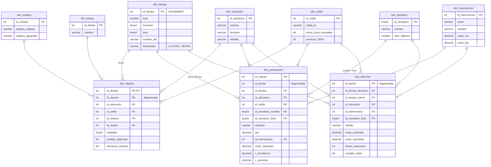

# SIPA · Data Warehouse y datamarts

Implementado en `09_dw_crear.sql`, `10_dw_etl.sql` y `11_dw_consultas_olap.sql`, en la base **`SIPA_DW`**, separada de la base transaccional `SIPA`.

## 1. ¿Por qué un Data Warehouse?

| Base transaccional `SIPA` (OLTP) | Data Warehouse `SIPA_DW` (OLAP) |
|---|---|
| Registra la operación diaria: reportes, decisiones, órdenes | Analiza la historia: tendencias, comparaciones, indicadores |
| Normalizada en 3FN para evitar redundancia | Desnormalizada (estrella) para consultar rápido |
| Muchas escrituras pequeñas, con transacciones | Pocas cargas masivas (ETL) y muchas lecturas |
| Responde «¿qué pasa con este bache?» | Responde «¿qué alcaldía cumple menos los tiempos en lluvias?» |

Separarlas evita que las consultas pesadas del tablero frenen el registro de reportes.

## 2. Modelo dimensional (constelación de hechos)

Tres tablas de hechos comparten las mismas dimensiones (*dimensiones conformadas*):



| Tabla de hechos | Granularidad (una fila es…) | Medidas principales |
|---|---|---|
| `fact_reporte` | un reporte ciudadano o histórico | cantidad, posible duplicado, ubicación dudosa |
| `fact_priorizacion` | un cálculo del IPU | IPU, costo estimado, valor de cada criterio, decisión humana |
| `fact_atencion` | un bache que la autoridad decidió atender | costo estimado por SIPA, costo reportado por la autoridad, horas desde la decisión hasta la reparación, cumplimiento de meta |

**Decisiones de diseño**
- **Jerarquías para drill-down:** tiempo (año → trimestre → mes → día), ubicación (entidad → territorio → colonia) y celda.
- **Fila «desconocido» (-1)** en cada dimensión, para no perder hechos con datos faltantes (por ejemplo, los 47 reportes sin colonia).
- **La temporada de lluvias está en `dim_tiempo`**, porque es el hallazgo más fuerte de los datos (casi el doble de reportes).
- **`dim_celda` precalcula** la cercanía a zonas inundables y los servicios a 500 m, para no repetir cálculos geográficos en cada consulta.
- **Dimensiones degeneradas:** `id_reporte` e `id_bache` se guardan en los hechos sin tabla propia, para poder regresar al detalle en `SIPA`.

## 3. Proceso ETL (`dw.sp_etl_cargar`)

```
SIPA (3FN) ──Extraer──▶ Transformar ──Cargar──▶ SIPA_DW (estrella)
```

| Paso | Transformaciones |
|---|---|
| Extraer | Lee de `SIPA.dbo.*` con nombres de tres partes (misma instancia) |
| Transformar | Llaves sustitutas; fecha → `id_tiempo` AAAAMMDD; colonia más frecuente de los reportes de cada bache; criterios del IPU de filas a columnas; horas de resolución; cumplimiento de meta |
| Cargar | Carga completa dentro de una transacción: si un paso falla, el DW queda como estaba |
| Bitácora | `dw.etl_bitacora` registra filas, duración y errores de cada paso |

Carga actual: 35,699 reportes, 1,646 cálculos de IPU y 301 baches atendidos, en unos 8 segundos.

## 4. Datamarts

| Datamart | Vistas | Para quién / para qué |
|---|---|---|
| `dm_priorizacion` | `v_ranking_baches`, `v_semaforo_territorio`, `v_celdas_criticas`, `v_reportes_vs_ipu` | Personal técnico: qué atender primero, dónde hacer conservación preventiva, contraste percepción vs. evidencia |
| `dm_financiero` | `v_costo_mensual`, `v_cumplimiento_semaforo`, `v_intervenciones` | Finanzas y dirección: costo estimado vs. reportado, cumplimiento de tiempos, inversión necesaria por tipo de intervención (insumo para Contabilidad) |

## 5. Operaciones OLAP (`11_dw_consultas_olap.sql`)

| Operación | Cómo se hace en SQL Server | Ejemplo |
|---|---|---|
| Roll-up | `GROUP BY ROLLUP` | reportes por territorio → año → total |
| Cubo | `GROUP BY CUBE` | temporada × estatus con todos los subtotales |
| Grouping sets | `GROUP BY GROUPING SETS` | por entidad, trimestre y día en una consulta |
| Pivot | `PIVOT` | un año por columna |
| Drill-down | filtros de nivel en nivel | Chalco → colonia → celda |
| Slice / dice | `WHERE` sobre una o varias dimensiones | turnados en lluvias, CDMX 2021-2022 |
| Ventanas | `OVER (… ROWS BETWEEN …)` | promedio móvil de 3 meses y acumulado anual |

## 6. Fragmentación y replicación

**Fragmentación horizontal (implementada).** `fact_reporte` está particionada por año (`pf_anio` / `ps_anio`). Las consultas de un año solo leen su partición, y los años viejos se pueden archivar sin tocar los recientes. En el prototipo todas las particiones están en el mismo disco; en producción cada una podría ir en un *filegroup* distinto.

| Partición | Filas |
|---|---|
| 2019 | 6,167 |
| 2020 | 6,666 |
| 2021 | 11,833 |
| 2022 | 10,963 |
| 2025 | 54 |
| 2026 | 16 |

**Fragmentación por territorio (propuesta).** Como cada municipio opera sus propios baches, las tablas de `SIPA` podrían repartirse por `id_territorio`: cada alcaldía o municipio con su servidor y un nodo central que consolide. Es la razón de que los pesos del IPU ya estén configurados por territorio.

**Replicación (implementada en `12_replicacion.sql`).** Réplica de solo lectura por *log shipping*:

```
SIPA (principal, escrituras) ──respaldo de log──▶ SIPA_REPLICA (solo lectura, STANDBY) ──▶ tablero / ETL
```

1. SIPA pasa al modelo de recuperación FULL, se respalda completa y se restaura como `SIPA_REPLICA` en modo **STANDBY**: se puede consultar, pero no modificar.
2. `dbo.sp_replicar` respalda el registro de transacciones de SIPA (los cambios desde el último envío) y lo aplica a la réplica. Cada envío queda en `dbo.replicacion_bitacora`.
3. En producción, el Agente de SQL Server ejecutaría `sp_replicar` cada cierto tiempo (por ejemplo, cada 15 minutos) y la réplica estaría en otro servidor.

La demostración del script comprueba cuatro cosas:

| Prueba | Resultado |
|---|---|
| Un reporte nuevo en la principal aparece en la réplica solo después de `sp_replicar` | Principal 35,701 → réplica 35,700 → tras replicar, 35,701 |
| La réplica rechaza escrituras | «the database is read-only» |
| El tablero (`rol_tablero`) lee `dbo` en la réplica | Permitido |
| El tablero intenta leer `priv.contacto_ciudadano` | Permiso denegado |

**Datos personales:** el *log shipping* copia la base completa, así que el esquema `priv` también llega a la réplica. La protección es por permisos: `rol_tablero` tiene `DENY SELECT` sobre `priv`, y ese permiso viaja con la réplica.

**Disponibilidad:** si la principal falla, la réplica sigue disponible para consultas. Si hiciera falta, se puede convertir en principal con `RESTORE DATABASE SIPA_REPLICA WITH RECOVERY`.

## 7. Limitaciones

- La atención es **simulada** (`08_simular_operacion.sql`): la autoridad de cada territorio decide sobre los 300 baches de mayor IPU y los informa como reparados, con un costo real de entre 85 % y 130 % del estimado y fechas repartidas en 2026. Los tiempos, el cumplimiento de meta y los costos reportados son ilustrativos.
- La carga es completa, no incremental. Con más volumen convendría cargar solo lo nuevo (por fecha de registro).
- El DW, la base transaccional y la réplica están en la misma instancia de SQL Server; la réplica se actualiza a mano, no con el Agente.
