# SIPA · Modelo Entidad-Relación

Diagrama del modelo relacional implementado en `01_crear_bd.sql`. Se ve renderizado en VS Code (extensión *Markdown Preview Mermaid Support*), en GitHub o pegando el bloque en https://mermaid.live para exportarlo como imagen.

Notación: `||--o{` = uno a muchos (opcional), `||--||` = uno a uno, `}o--o{` = muchos a muchos (resuelta con `ruta_tramo`).

```mermaid
erDiagram
    territorio ||--o{ colonia : contiene
    territorio ||--o{ peso_criterio : configura
    territorio ||--o{ usuario : "autoridad de"
    territorio ||--o{ zona_inundable : delimita
    territorio ||--o{ equipamiento : ubica
    colonia ||--o{ tramo : contiene
    colonia ||--o{ reporte : ubica
    tipo_vialidad ||--o{ tramo : clasifica
    celda ||--o{ tramo : contiene
    celda ||--o{ bache : contiene
    celda ||--o{ reporte : contiene
    celda ||--o{ accidente : contiene
    celda ||--o| riesgo_celda_72h : estima

    tramo ||--o{ bache : tiene
    tramo ||--o{ aforo : mide
    tramo ||--o{ accidente : registra
    tramo ||--o{ ruta_tramo : ""
    ruta_transporte ||--o{ ruta_tramo : recorre

    cat_fuente_reporte ||--o{ reporte : origina
    cat_estatus_reporte ||--o{ reporte : clasifica
    cat_estado_bache ||--o{ bache : estado
    bache ||--o{ reporte : "agrupa duplicados"
    reporte ||--o| contacto_ciudadano : "priv (opcional)"
    reporte ||--o{ notificacion : recibe
    seguimiento_bache ||--o{ notificacion : genera

    criterio_ipu ||--o{ peso_criterio : pondera
    criterio_ipu ||--o{ detalle_calculo : desglosa
    bache ||--o{ calculo_prioridad : prioriza
    calculo_prioridad ||--|{ detalle_calculo : justifica
    calculo_prioridad ||--o{ decision_humana : revisa
    usuario ||--o{ decision_humana : toma

    tarifa_reparacion ||--o{ calculo_prioridad : "costea (JSON)"
    bache ||--o{ seguimiento_bache : "avance informado"
    usuario ||--o{ seguimiento_bache : informa
    cat_estado_bache ||--o{ seguimiento_bache : "estado nuevo"

    territorio {
        int id_territorio PK
        varchar nombre
        varchar tipo
        varchar entidad
    }
    colonia {
        int id_colonia PK
        int id_territorio FK
        varchar nombre
        varchar clave_oficial
        varchar tipo_asentamiento
        decimal indice_marginacion
        int poblacion
    }
    riesgo_celda_72h {
        varchar celda_id PK,FK
        int acc_total
        bit via_rapida
        decimal p72_accidente "CHECK 0-1"
        varchar semaforo_72h "CHECK ROJO/AMARILLO/VERDE"
        decimal v_riesgo_72h "CHECK 0-1, criterio RIESGO_72H"
    }
    celda {
        varchar celda_id PK
        decimal latitud
        decimal longitud
    }
    tramo {
        int id_tramo PK
        varchar nombre_vialidad
        tinyint id_tipo_vialidad FK
        int id_colonia FK
        varchar celda_id FK
        decimal longitud_m
    }
    bache {
        int id_bache PK
        int id_tramo FK
        varchar celda_id FK
        tinyint severidad "CHECK 1-5"
        decimal profundidad_cm
        decimal area_m2
        tinyint id_estado_bache FK
        date fecha_deteccion
    }
    reporte {
        int id_reporte PK
        int folio_origen "UNIQUE filtrado"
        tinyint id_fuente FK
        int id_bache FK
        int id_colonia FK
        varchar celda_id FK
        date fecha_solicitud
        varchar estatus_original FK
        bit ubicacion_dudosa
        bit posible_duplicado
    }
    contacto_ciudadano {
        int id_contacto PK
        int id_reporte FK "UNIQUE"
        varchar medio
        varchar dato_contacto
        bit consentimiento "CHECK = 1"
    }
    aforo {
        int id_aforo PK
        int id_tramo FK
        date fecha_medicion
        int vehiculos_dia
        decimal pct_carga_pesada
    }
    ruta_transporte {
        int id_ruta PK
        varchar nombre
        varchar tipo
        int pasajeros_dia
    }
    ruta_tramo {
        int id_ruta PK,FK
        int id_tramo PK,FK
    }
    zona_inundable {
        int id_zona PK
        int id_territorio FK
        varchar clave
        geography poligono
        varchar fuente
    }
    equipamiento {
        int id_equipamiento PK
        int id_territorio FK
        varchar tipo "ESCUELA, HOSPITAL, MERCADO"
        varchar nombre
        int personas
        geography ubicacion "calculada"
    }
    accidente {
        int id_accidente PK
        int id_tramo FK
        varchar celda_id FK
        date fecha
        varchar gravedad
    }
    criterio_ipu {
        tinyint id_criterio PK
        varchar clave
        varchar nombre
    }
    peso_criterio {
        int id_territorio PK,FK
        tinyint id_criterio PK,FK
        date vigente_desde PK
        date vigente_hasta
        decimal peso "CHECK 0-1"
    }
    calculo_prioridad {
        int id_calculo PK
        int id_bache FK
        decimal ipu
        varchar semaforo
        varchar clave_tarifa FK
        decimal costo_estimado
        varchar version_modelo
    }
    detalle_calculo {
        int id_calculo PK,FK
        tinyint id_criterio PK,FK
        decimal valor_normalizado
        decimal peso_aplicado
    }
    usuario {
        int id_usuario PK
        varchar nombre
        varchar rol "AUTORIDAD, ANALISTA, ADMIN"
        int id_territorio FK
    }
    decision_humana {
        int id_decision PK
        int id_calculo FK
        int id_usuario FK
        varchar decision
        varchar semaforo_ajustado
        varchar justificacion "obligatoria si ajusta"
    }
    tarifa_reparacion {
        varchar clave PK
        varchar nombre
        decimal costo_m2 "CHECK > 0"
        decimal costo_fijo
        decimal area_minima_m2
        varchar version "del archivo JSON"
    }
    cat_estado_bache {
        tinyint id_estado_bache PK
        varchar nombre
    }
    seguimiento_bache {
        int id_seguimiento PK
        int id_bache FK
        tinyint id_estado_anterior FK
        tinyint id_estado_nuevo FK
        int id_usuario FK "autoridad"
        datetime fecha
        varchar comentario "obligatorio si descarta"
        decimal costo_reportado "solo al reparar"
    }
    notificacion {
        int id_notificacion PK
        int id_reporte FK
        int id_seguimiento FK
        varchar medio
    }
```

## Justificación de la normalización (3FN)

| Forma normal | Cómo se cumple |
|---|---|
| **1FN** | Todos los atributos son atómicos. Las rutas de un tramo no se guardan como lista: se resuelven con la tabla puente `ruta_tramo`. |
| **2FN** | En las tablas con llave compuesta (`peso_criterio`, `detalle_calculo`, `ruta_tramo`), cada atributo depende de la llave completa, no de una parte. |
| **3FN** | Se eliminaron las dependencias transitivas de la base original: `alcaldia` depende de `colonia`, así que no se repite en `reporte`; `anio`, `mes` y `anio_mes` se derivan de `fecha_solicitud`; `estatus` (agrupado) depende de `estatus_original` y vive en `cat_estatus_reporte`; las coordenadas del centro de celda viven en `celda`. |

**Decisiones de diseño**

- **Celda vs. tramo:** la base maestra no trae calle, así que la celda de la cuadrícula es la unidad espacial disponible hoy; `tramo` queda listo para cuando se carguen datos viales (OpenStreetMap / INEGI).
- **Bache vs. reporte:** se separan porque varios reportes describen el mismo daño. Así se cuentan daños reales y no avisos repetidos.
- **Privacidad:** los datos de contacto están en el esquema `priv`, en relación 1:1 opcional y con consentimiento obligatorio.
- **Datos geográficos:** `zona_inundable` guarda polígonos y `equipamiento` puntos con el tipo `GEOGRAPHY` de SQL Server; el IPU usa `STDistance` para saber si un bache está dentro o cerca de una zona inundable y cuántos servicios tiene a menos de 500 m.
- **Varios territorios:** CDMX (16 alcaldías) y Chalco (55 comunidades del Bando 2026) conviven en las mismas tablas; cada territorio tiene sus propios pesos del IPU.
- **Auditoría:** `calculo_prioridad`, `detalle_calculo`, `decision_humana` y `seguimiento_bache` nunca se sobrescriben, para poder reconstruir por qué se tomó cada decisión.
- **Alcance de asesoría:** SIPA recomienda qué atender, por qué y cuánto costaría; la reparación la hace la autoridad con sus propios recursos. Por eso no hay tablas de brigadas, almacenes, material ni presupuesto (estaban en la primera versión y se quitaron en noviembre de 2026). La autoridad solo informa el avance en `seguimiento_bache`, y el costo estimado sale de `tarifa_reparacion`, que se carga desde un archivo JSON (`datos/costos/tarifas_reparacion.json`) que cada autoridad puede reemplazar por su tabulador.
- **Dos modos de uso:** el ciudadano reporta y consulta su folio sin cuenta (rol `rol_ciudadano`, solo puede ejecutar `sp_registrar_reporte` y `sp_consultar_folio`); la autoridad tiene cuenta en `usuario`, ligada a su territorio, y es la única que decide sobre la recomendación y cambia el estado del bache (rol `rol_autoridad`).

## Tablas de apoyo fuera del modelo operativo

- **`riesgo_celda_72h`** (`05b_riesgo_72h.sql`): riesgo de accidente a 72 h por celda, calculado por el modelo de Probabilidad. Alimenta el criterio RIESGO_72H del IPU (v0.3). Es 1:0..1 con `celda`.
- **`parada_transporte`**, **`marginacion_colonia`** y **`contexto_celda`** (`05c_transporte_marginacion.sql`): paradas del GTFS con sus salidas por día, polígonos de colonias con el índice de marginación 2020 de CONAPO, y su resumen por celda (`v_transporte`, `v_vulnerabilidad`) para los criterios TRANSPORTE y VULNERABILIDAD (IPU v0.4). Las colonias de CONAPO no se fusionan con `colonia`: tienen otra delimitación (polígonos oficiales, no los nombres de los reportes), así que se cruzan por ubicación.
- **`ind.reporte_reaparicion`** (`13_vistas_indicadores.sql`): clasificación de cada reporte como NUEVO, DUPLICADO o REAPARICION. Es un resultado derivado (se recalcula con `ind.sp_actualizar_reincidencia`), por eso no forma parte de la normalización; las vistas del esquema `ind` la usan para los indicadores de reincidencia, tiempo de respuesta, cobertura y costo pendiente.
